# دليل استعمال نظام إيواء

لكل دور قسمه. الصور من النظام العامل ببيانات تجريبية.

**قاعدتان تجدهما في كل موضع:**

1. **من أدخل لا يعتمد.** كل ما يمسّ عائلة أو مالاً يشهد عليه اثنان: واحد يُدخل، وآخر يعتمد. فإن لم تجد زرّ الاعتماد على شيء أدخلتَه أنت، فذلك مقصود.
2. **كل عملية تُسجَّل باسم صاحبها.** لا يُحذف شيء من السجل؛ وما أُخطئ فيه يُصحَّح بعملية مقابلة لها سببها.

---

## الدخول والحساب (لكل الأدوار)

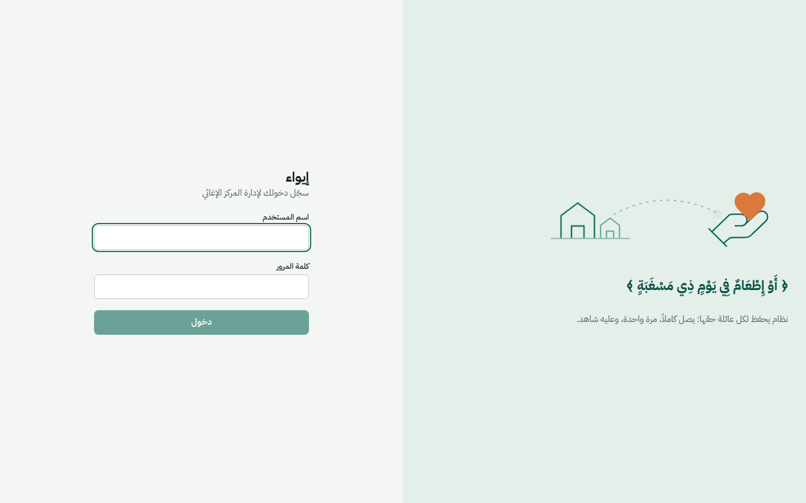

- اكتب اسم المستخدم وكلمة المرور اللذين أعطاكهما مدير النظام.
- **أول دخول**: الكلمة التي أعطاكها المدير مؤقتة. يطلب منك النظام أن تضع كلمة لا يعرفها غيرك (12 خانة على الأقل) قبل أن تتابع.
- **خمس محاولات خاطئة** تقفل الحساب ربع ساعة. إن استعجلت فراجع المدير ليفكّه.
- نسيت كلمة المرور؟ راجع المدير ليضع لك كلمة مؤقتة.

### التحقق بعاملين

لمن يملك المال أو الصلاحيات (المدير والمحاسب) مطلوب، ولغيرهم مستحسن.

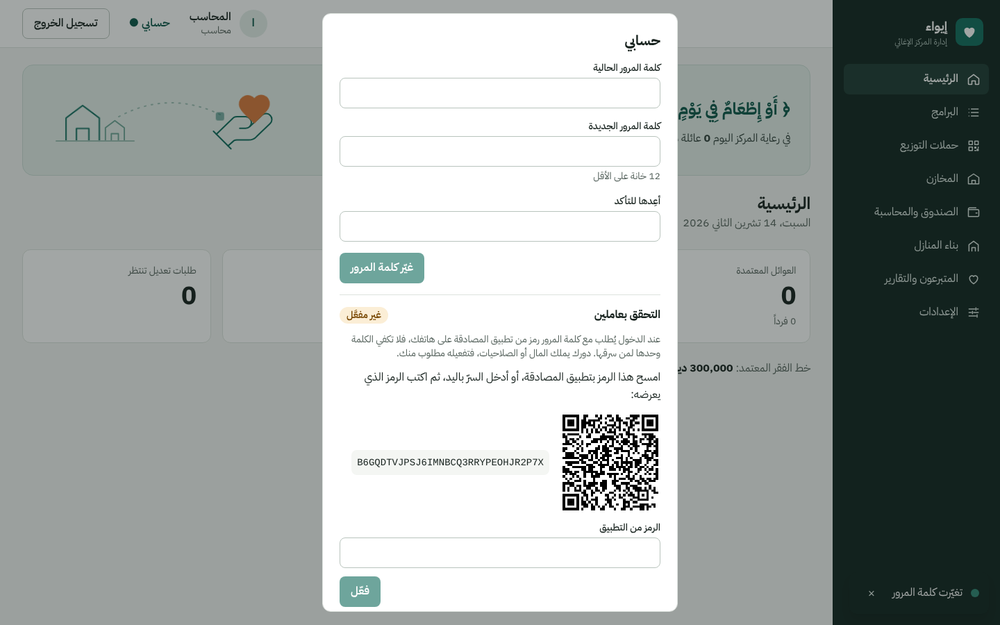

1. اضغط «حسابي» أعلى الصفحة، ثم «ابدأ التفعيل».
2. نصّب على هاتفك تطبيق مصادقة (Google Authenticator أو ما يماثله)، وامسح به الرمز الظاهر.
3. اكتب الأرقام الستة التي يعرضها التطبيق، واضغط «فعّل».
4. بعدها يطلب النظام عند كل دخول رمزاً من التطبيق مع كلمة المرور.

فقدت الهاتف؟ المدير يعطّل التحقق عن حسابك فتدخل بكلمة مرورك ثم تفعّله من جديد.

---

## الباحث الميداني

### تسجيل عائلة

«العوائل» ← «تسجيل عائلة». المعالج خمس خطوات على ترتيب الاستمارة الورقية:

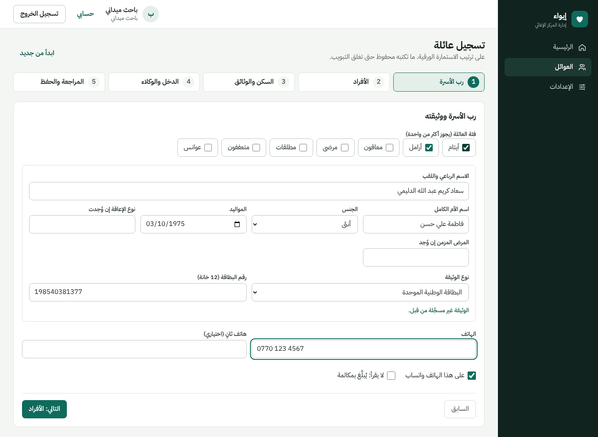

1. **رب الأسرة**: فئة العائلة، اسمه الرباعي، اسم أمه، مواليده، وثيقته، وهاتفه.
   - الوثيقة إمّا **البطاقة الوطنية الموحدة** (12 خانة)، وإمّا **هوية الأحوال القديمة** (رقم وسجل وصفحة) أو **شهادة الجنسية** (رقم ومحفظة).
   - علّم «لا يقرأ» لمن يُبلَّغ بمكالمة، وأزل علامة الواتساب عمّن لا واتساب له.
2. **الأفراد**: كل فرد باسمه. المتوفى يُسجَّل بعلامة «متوفى». عدد الأفراد يحسبه النظام.
3. **السكن والوثائق**: العنوان، نوع العقار، البطاقة التموينية، بطاقة السكن.
4. **الدخل والوكلاء**: كل مصدر دخل بمبلغه. والوكيل هو من يجوز له أن يستلم عن العائلة؛ **لا يستلم إلا مسجَّل هنا**.
5. **المراجعة والحفظ**.

ما تكتبه محفوظ حتى تغلق التبويب، فانقطاع الشبكة أو تحديث الصفحة لا يُضيعه.

### إذا كان الشخص مسجَّلاً

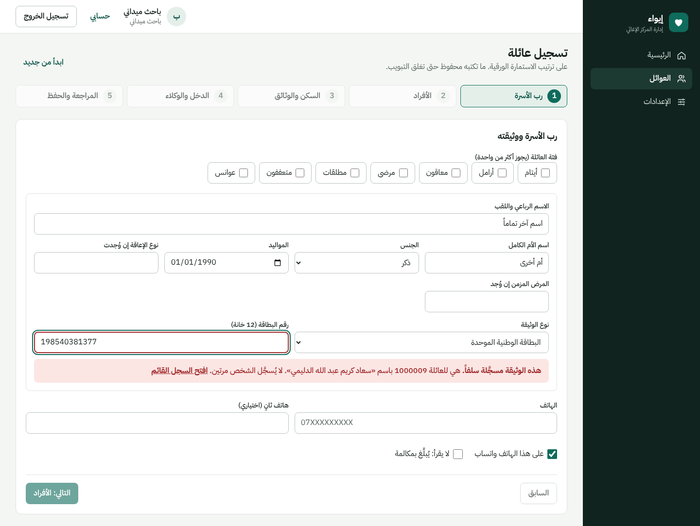

ما إن تُكمل رقم الوثيقة حتى يفحصها النظام. إن كانت مسجَّلة أخبرك باسم صاحبها ورقم عائلته، ومنعك من المضيّ. **لا تحاول تسجيله بوثيقة أخرى**: افتح السجل القائم، وإن احتاج تعديلاً فاطلبه.

### بعد الحفظ

- يذهب السجل إلى صف الاعتماد، ويعتمده مشرف المستفيدين.
- إن شابه اسمُ أحد الأفراد اسماً في النظام مع قرينة (اسم الأم، أو الهاتف، أو تاريخ الميلاد)، عُلّق السجل حتى يفصل فيه المشرف.
- **المرفقات اختيارية**: صور أو PDF حتى 10 ميغابايت، من ملف أو من الكاميرا.

### تعديل عائلة مسجَّلة

من ملف العائلة: «طلب تعديل». اختر ما تعدّله واكتب السبب. **لا يسري حتى يعتمده غيرك.**

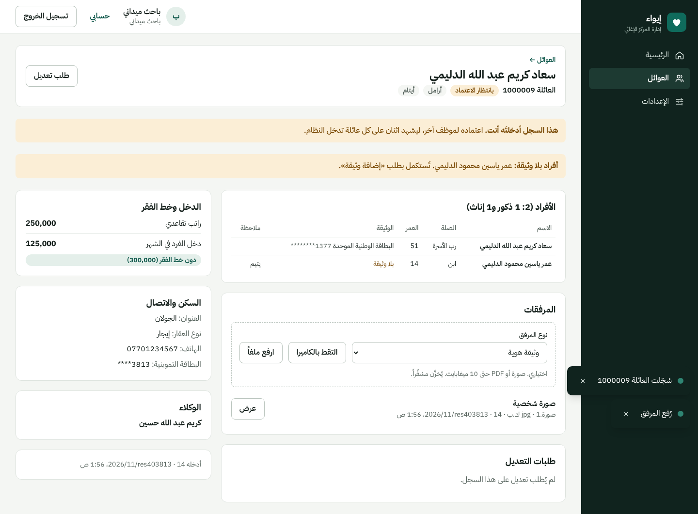

يشمل: الهاتف والعنوان والسكن، الدخل، إضافة فرد (ولادة)، تغيير حال فرد (وفاة، يُتم، إعاقة، مرض)، وإضافة وثيقة لمن حدّث هويته القديمة إلى البطاقة الوطنية.

- **تغيير رب الأسرة** (وفاة، سفر، انفصال): اختر الرب الجديد من أفراد العائلة الأحياء. يلزم أن تكون له وثيقة مسجَّلة؛ فإن لم تكن فأضفها بطلب «إضافة وثيقة» أولاً.
- **نقل فرد إلى عائلة أخرى** (زواج، كفالة): اكتب رقم العائلة المنقول إليها وصلته برب أسرتها. تنتقل معه وثائقه ومرفقاته، وتُعاد نقاط العائلتين. رب الأسرة لا يُنقل حتى يُغيَّر.

### بطاقة العائلة

من ملف العائلة المعتمدة: «اطبع البطاقة». فيها رقم العائلة ورمزه ومن يستلم عنها. **هي تعريف بالعائلة، وليست رمز استلام**: الاستلام برمز الحملة.

---

## مشرف المستفيدين

### صف القرارات

«الاعتماد والشبهات»، وعلى اسمه في القائمة عدد ما ينتظرك. فيه ثلاثة ألسنة:

- **اعتماد التسجيل**: افتح السجل، راجعه، ثم «اعتماد» أو «رفض السجل» بسببه.
- **شبهات التكرار**: السجلّان متقابلان والفروق مُعلَّمة.
- **طلبات التعديل**: ما يُراد تغييره وسببه.

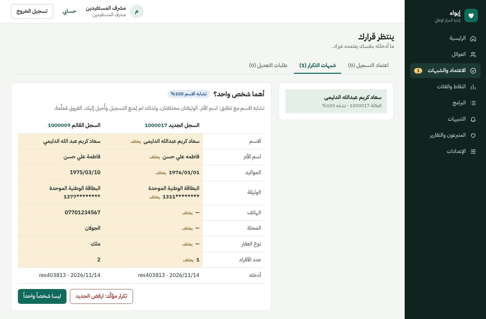

في الشبهة قراران، وكلاهما بسبب مكتوب:

- **«ليسا شخصاً واحداً»**: تُصرف الشبهة ويعود السجل إلى صف الاعتماد.
- **«تكرار مؤكَّد»**: يُرفض السجل الجديد ويبقى القائم.

### استيراد السجلات القديمة من Excel

«العوائل» ← «استيراد من Excel» (للمشرف والمدير).

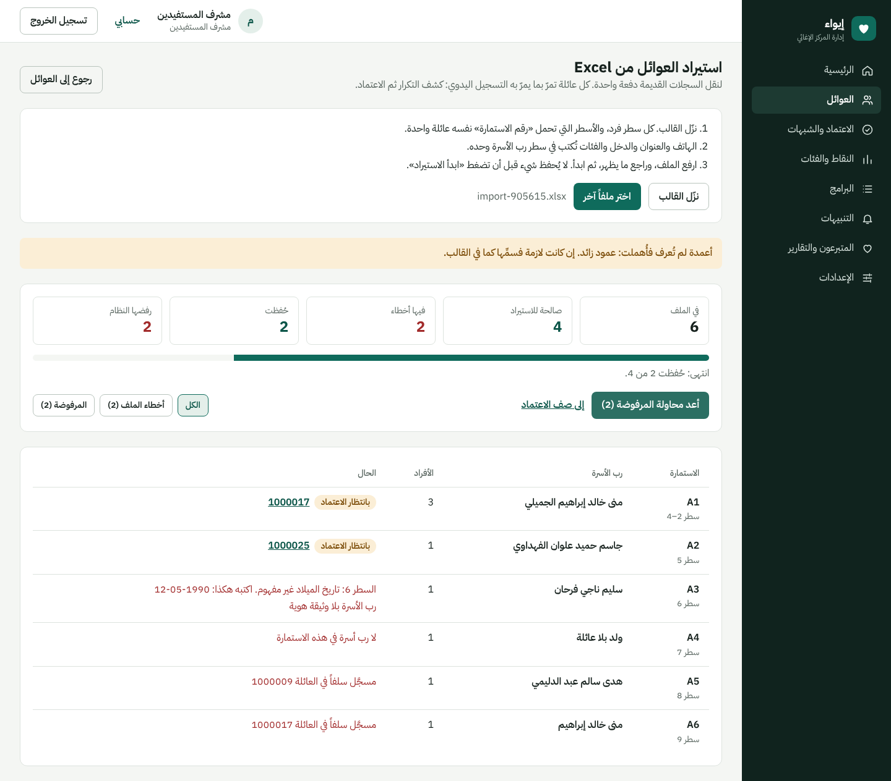

1. **نزّل القالب** وانقل إليه سجلاتك. كل سطر فرد، والأسطر التي تحمل «رقم الاستمارة» نفسه عائلة واحدة. الهاتف والعنوان والدخل والفئات تُكتب في سطر رب الأسرة وحده.
2. **ارفع الملف**. يعرض النظام ما فهمه: الصالح، وما فيه خطأ برقم سطره وسببه. **لا يُحفظ شيء في هذه المرحلة.**
3. **«ابدأ الاستيراد»**. كل عائلة تمرّ بكشف التكرار نفسه ثم تدخل صف الاعتماد؛ فالاستيراد لا يعتمد أحداً.

من كانت وثيقته مسجَّلة رُفض وذُكر رقم العائلة التي تحملها؛ فإعادة رفع الملف نفسه لا تكرّر أحداً. وإن انقطعت الشبكة فاضغط «تابع».

### إعادة التقييم

لا يُعاد تقييم عائلة إلا بطلب: منها، أو من الإدارة.

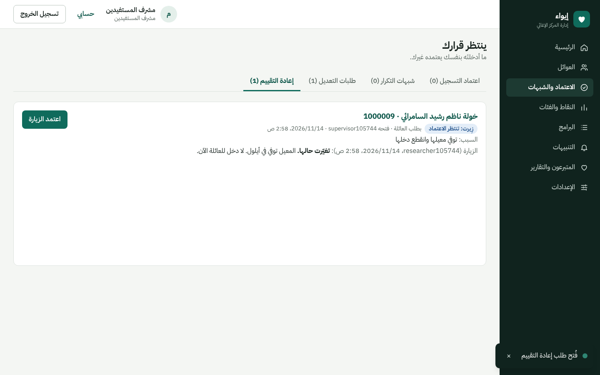

1. **فتح الطلب**: من ملف العائلة المعتمدة، «افتح طلب إعادة تقييم». اكتب السبب، ومن طلبه، ومن يزورها (أو اتركها لأي باحث).
2. **الزيارة**: يجدها الباحث في «زيارات إعادة تقييم مطلوبة» أعلى قائمة العوائل، وفي تطبيق الميدان. يزور، ثم «سجّل الزيارة»: ما رآه بعينه، وهل تغيّرت حالها.
3. **إن تغيّرت**: يقدّم الباحث ما تغيّر بـ«طلب تعديل» (الدخل، الأفراد، السكن). الزيارة وحدها لا تغيّر بيانات.
4. **الاعتماد**: من لسان «إعادة التقييم» في صف القرارات، يعتمدها **غير من زار**. ولا تُعتمد وللعائلة طلب تعديل معلّق.

باعتمادها تُعاد نقاط العائلة، وتخرج من تقرير «ملفات تقادم تقييمها».

### النقاط والفئات

بعد الاعتماد يحسب النظام نقاط العائلة وفئتها. في ملف العائلة بطاقة «لماذا هذه النقاط؟» تبيّن ما أعطاه كل معيار.

---

## مدير النظام

### المستخدمون

«المستخدمون» ← «إضافة مستخدم»: الاسم، اسم المستخدم، كلمة مرور مؤقتة، والدور. ومن الصف نفسه: تغيير الدور، التعطيل (يسري فوراً ولو كان صاحبه داخلاً)، وضع كلمة مؤقتة، وفكّ القفل.

### أجهزة الميدان

في أسفل «المستخدمون»: كل هاتف نُصّب عليه تطبيق الميدان، باسم موظفه وآخر ظهوره.

**إن ضاع هاتف فاسحبه** بسببه. تُرفض طلباته من حينها، ويمحو التطبيق ما عليه حين يتصل، **ومنه ما لم يُرفع**. والهاتف الذي لا يتصل لا يبلغه السحب، وما عليه مشفّر برمز قفله؛ فإن كان بيد من لا يؤتمن فعطّل حساب صاحبه أيضاً.

### أوزان النقاط وحدود الفئات

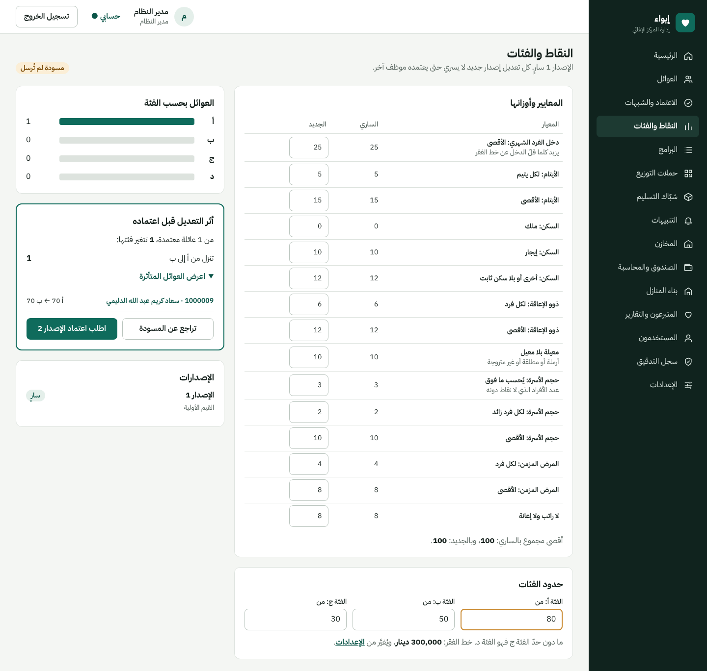

1. غيّر وزناً أو حدّاً. يظهر فوراً **أثر التعديل**: كم عائلة ترتفع وكم تنزل، ومن هي.
2. «اطلب اعتماد الإصدار»، وأقرّ بأنك اطّلعت على الأثر.
3. لا يسري حتى يعتمده موظف آخر؛ وعندها تُعاد نقاط العوائل كلها.

**خط الفقر** من «الإعدادات»، وتغييره يعيد النقاط كذلك.

### البرامج

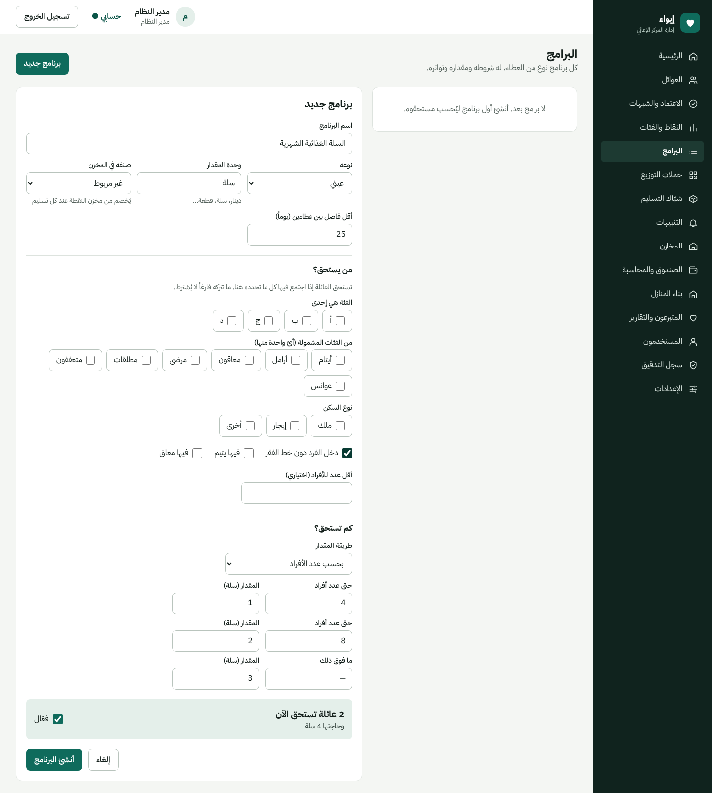

البرنامج نوع من العطاء. تحدد له:

- **من يستحق**: الفئة، خط الفقر، الفئات المشمولة، السكن، عدد الأفراد، يتيم، معاق. ما تتركه فارغاً لا يُشترط.
- **كم يستحق**: مقدار ثابت، أو بحسب عدد الأفراد، أو لكل فرد، أو لكل يتيم.
- **أقل فاصل بين عطاءين**.

يعرض النظام عدد المستحقين وحاجتهم قبل أن تحفظ.

### سجل التدقيق

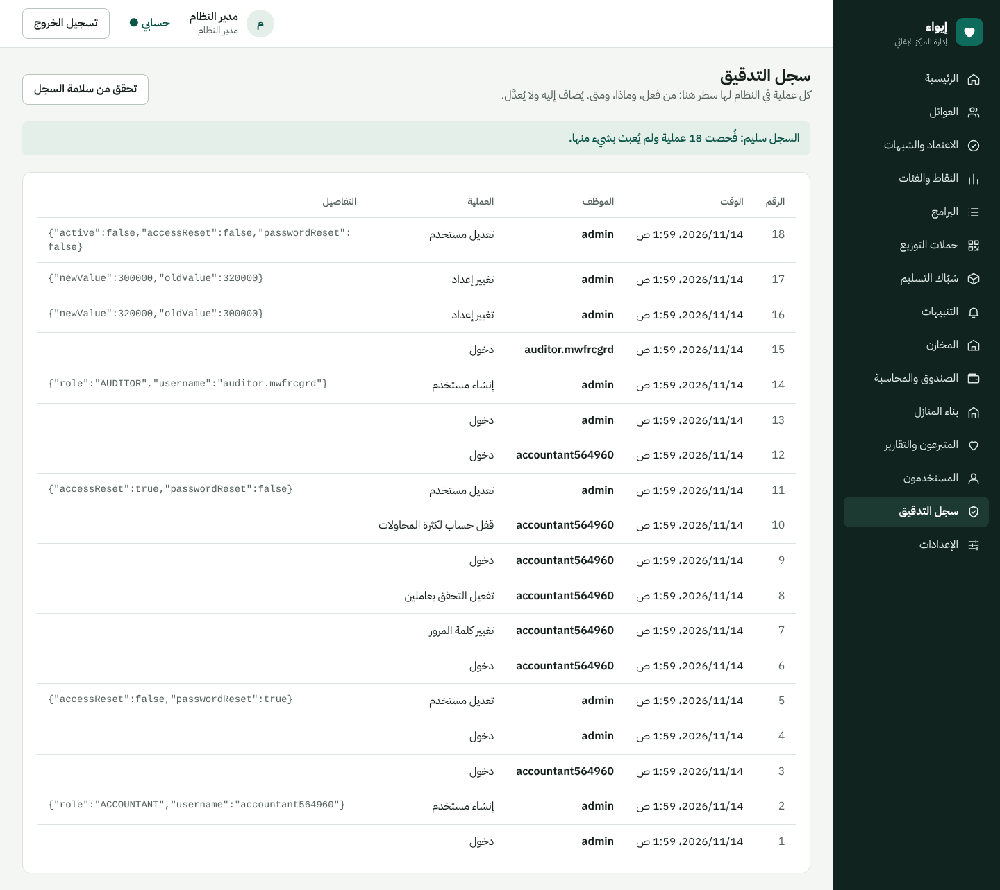

كل عملية بصاحبها ووقتها. زرّ «تحقق من سلامة السجل» يعيد حساب السلسلة كلها؛ فإن عُبث بسطر دلّ على موضعه.

---

## مدير التوزيع

### إنشاء حملة

«حملات التوزيع» ← «حملة جديدة»: البرنامج، الاسم، المدة، والنقاط. يأخذ النظام المستحقين من قواعد البرنامج **لحظة الإنشاء** ويقسّمهم على النقاط بالتساوي. من استلم قريباً يُستثنى.

ثم «أرسل للاعتماد». يعتمدها مدير توزيع آخر أو مدير النظام، وعندها:

- تصدر الرموز.
- تخرج دعوة الاستلام إلى كل عائلة برمزها الرقمي.

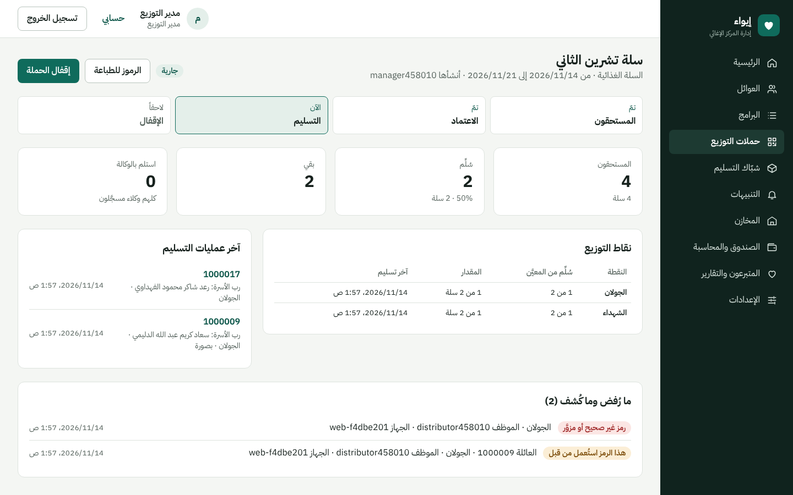

صفحة الحملة تتحدّث وحدها: ما سُلِّم في كل نقطة، آخر التسليمات، وما رُفض من الرموز بسببه وموظفه.

### بطاقات الرموز

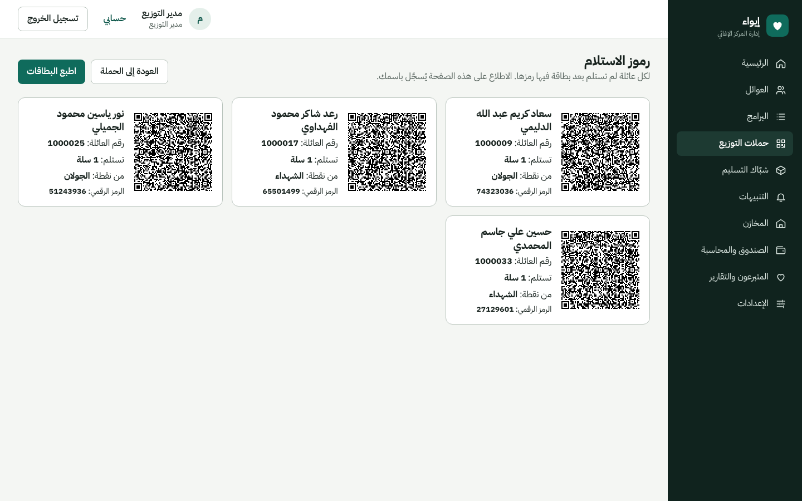

«الرموز للطباعة»: بطاقة لكل عائلة لم تستلم، فيها رمز QR ورمزها الرقمي. تُطبع وتُوزَّع على من لا واتساب له. **من ملك البطاقة ملك الاستلام**، فالاطلاع على هذه الصفحة يُسجَّل باسمك.

### التنبيهات

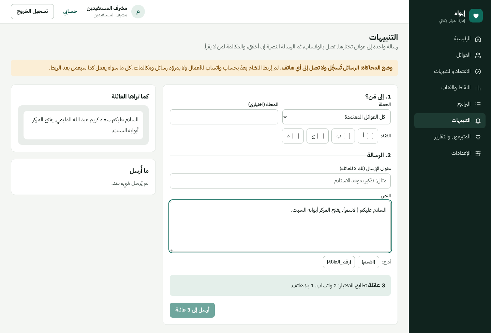

اختر المخاطَبين (حملة، من لم يستلم، نقطة، فئة، محلة)، واكتب النص. ما بين القوسين `{الاسم}` يُملأ لكل عائلة. يعرض النظام العدد بقنواته والرسالة باسم حقيقي قبل الإرسال. ما فوق 500 رسالة يحتاج اعتماداً.

**لعائلة بعينها**: من ملفها، بطاقة «الرسائل» ← «نبّه هذه العائلة». ترى النص باسمها قبل الإرسال، وتبقى الرسالة في ملفها بحالها (خرجت، بلغت الهاتف، قُرئت، أخفقت).

### الإقفال

«إقفال الحملة» يُلغي رموز من لم يستلم. **انتظر مزامنة كل الأجهزة قبله.**

---

## موظف التوزيع

«شبّاك التسليم». اختر الحملة ونقطتك مرة، ثم لكل عائلة ثلاث خطوات:

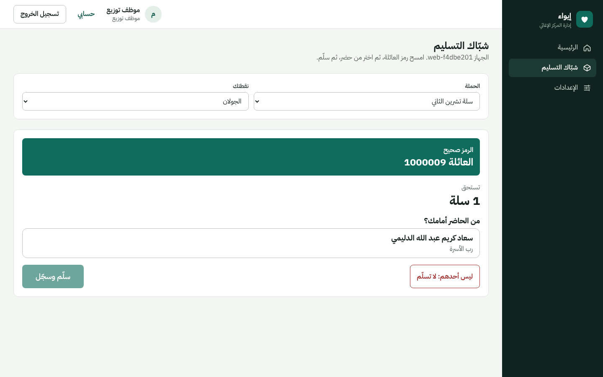

1. **امسح الرمز** بقارئ الرموز (يكتبه ويضغط إدخال وحده)، أو اكتب رقم العائلة ورمزها الرقمي.
2. **اختر من حضر**: رب الأسرة أو وكيل مسجَّل. إن لم يكن أحدهم: «لا تسلّم».
3. **«سلّم وسجّل»**، ثم صوّر التسليم إن شئت.

تصل العائلةَ رسالةٌ تسمّي من استلم ومتى وأين؛ فإن لم تكن هي علمت في حينه.

### إذا ظهرت «لا تسلّم»

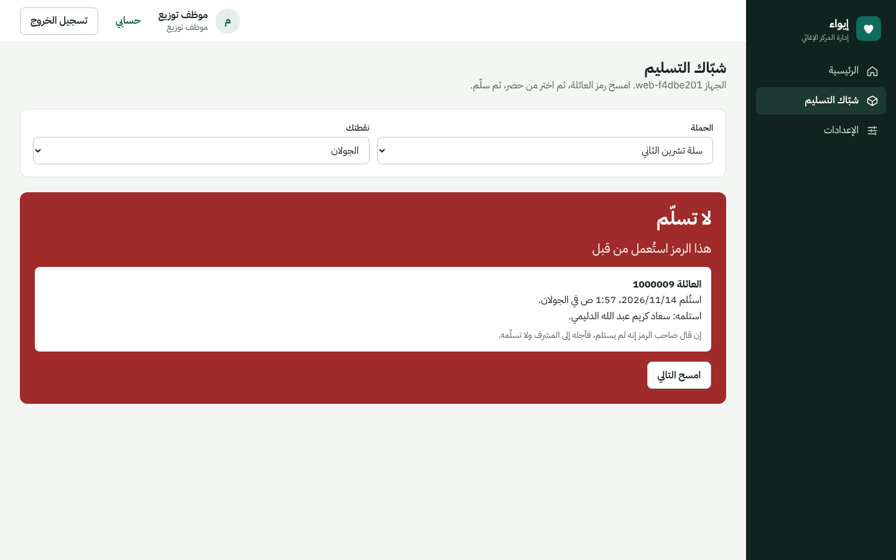

| الرسالة | معناها | ما تفعل |
|---|---|---|
| هذا الرمز استُعمل من قبل | استُلم به، ويُعرض من استلم ومتى | أرِ صاحبه ذلك. إن أنكر فأحِله إلى المشرف |
| رمز غير صحيح أو مزوَّر | ليس من إصدار النظام | لا تسلّم، وأبلغ المشرف |
| انتهت مدة الحملة / ليست جارية | فات الموعد أو أُقفلت | أحِله إلى المشرف |
| رقم العائلة أو الرمز الرقمي غير صحيح | خطأ في الإدخال | أعد الإدخال |

كل رفض يُسجَّل باسمك وجهازك، ويراه مدير التوزيع.

---

## تطبيق الميدان على الهاتف

لموظف التوزيع والباحث الميداني. يعمل ولو انقطع الاتصال، ويرفع ما سُجّل عليه حين يعود.

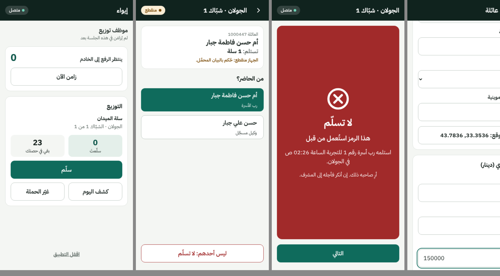

### التنصيب وأول استعمال

1. افتح على الهاتف في Chrome عنوان النظام متبوعاً بـ`/m/`، ثم من قائمة المتصفح: «إضافة إلى الشاشة الرئيسية».
2. **والهاتف متصل**: ادخل باسمك وكلمة مرورك. (من كانت كلمته مؤقتة يغيّرها من الحاسوب أولاً.)
3. ضع **رمز قفل من ستة أرقام**. به تُشفَّر بيانات الجهاز، وبه يُفتح التطبيق كل مرة.

**من نسي الرمز خسر ما لم يُرفع.** فزامن قبل أن تسلّم الهاتف لغيرك، ولا تكتب الرمز عليه.

يُقفل التطبيق وحده إن غاب عن الشاشة خمس دقائق. وثلاث محاولات خاطئة تؤخّر المحاولة التالية، ويتضاعف التأخير.

### للتوزيع

**قبل الخروج إلى النقطة، والهاتف متصل**: «اختر الحملة والنقطة» ← الحملة، النقطة، عدد الشبابيك، وشبّاكك ← «حمّل البيان».

> إن عمل في النقطة أكثر من هاتف فليأخذ كل هاتف **شبّاكاً غير شبّاك صاحبه**، وليتفقوا على العدد. بهذا يقتسمون العوائل، فلا يُقبل رمز في هاتفين والاتصال منقطع.

ثم «سلّم»، ولكل عائلة:

1. **وجّه الكاميرا إلى الرمز**، أو «اكتب رقم العائلة ورمزها».
2. **اختر الحاضر**: رب الأسرة أو وكيل مسجَّل. إن لم يكن أحدهم: «ليس أحدهم: لا تسلّم».
3. تظهر **«سُجّل التسليم»**. صوّر إن شئت، ثم «التالي».

| حال الهاتف | من يُقبل | من يحكم |
|---|---|---|
| **متصل** | أي عائلة في الحملة، ولو كانت لنقطة أخرى (بتنبيه) | الخادم، في لحظته |
| **منقطع** | عوائل شبّاكك وحدها | البيان المحمَّل |

والهاتف منقطع، من ليس من حصتك يظهر له «لا تسلّم: ليس من حصة هذا الجهاز». وجّهه إلى شبّاكه، أو انتظر عودة الاتصال.

**آخر اليوم**: «زامن الآن» حتى يصير «ينتظر الرفع» صفراً، ثم «كشف اليوم»: ما سلّمتَه وما بقي. إن ظهر «سُلِّم قبلك» فقد استُلم بالرمز نفسه في مكان آخر قبل أن يرفع هاتفك، وقد رُفع به بلاغ إلى مدير التوزيع.

### لزيارات إعادة التقييم

«الزيارات المطلوبة»: ما طُلب منك زيارته، باسم العائلة وعنوانها وهاتفها وسبب الطلب. القائمة تتجدد عند كل مزامنة، فزامن قبل الخروج. بعد الزيارة: «سجّل الزيارة»، واكتب ما رأيتَه. تُحفظ على الهاتف وتُرفع حين يتصل، ويعتمدها المشرف.

### للتسجيل

«سجّل عائلة»: رب الأسرة ووثيقته، الأفراد، الفئات والسكن، الدخل، وكيل، موقع الدار، وصور الوثائق. ثم «احفظ على الجهاز».

- **كشف التكرار يقع عند الرفع لا في الميدان.** فإن كانت الوثيقة مسجَّلة من قبل ردّها الخادم، وظهر في «ما سجّلتَه» رقم العائلة التي تحملها.
- الصور تُصغَّر على الهاتف قبل حفظها، وتُمحى منه بعد أن تبلغ الخادم.

---

## أمين المخزن

«المخازن»: المخزن الرئيس ومخزن لكل نقطة.

- **تسجيل وارد**: الصنف، الكمية، الصلاحية، والمصدر (مورّد أو متبرع).
- **تحويل إلى نقطة**: لا يخرج ما ليس في الرصيد. إن كان لحملة فانسبه إليها لتدخل في مطابقتها.
- **راجع من نقطة**.
- **تالف**: بسببه، **ولا يُخصم حتى يعتمده موظف آخر**.

كل تسليم بالرمز يخصم من مخزن نقطته وحده.

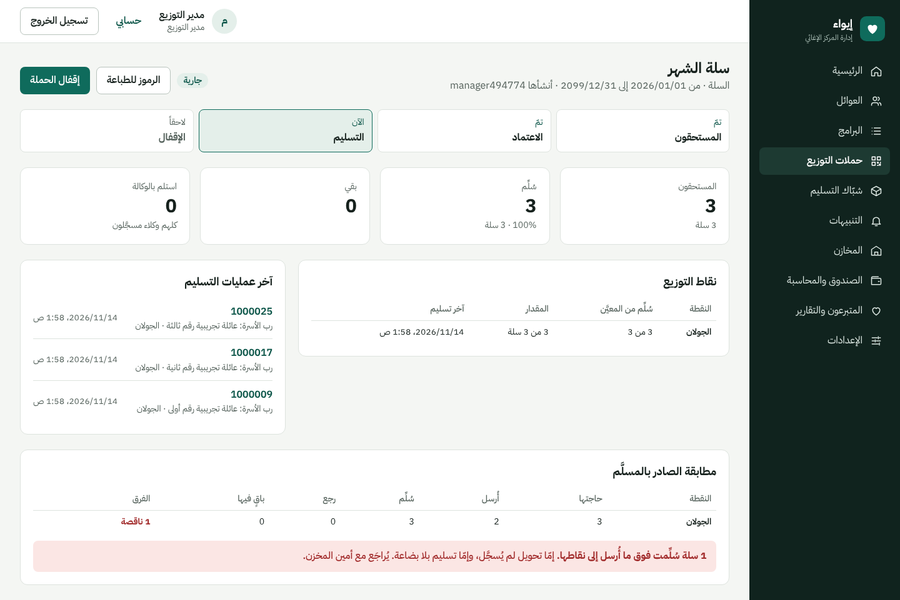

في صفحة كل حملة عينية جدول المطابقة: **ما أُرسل = ما سُلِّم + ما رجع + ما بقي**. كل نقص يظهر بعدده.

---

## المحاسب

«الصندوق والمحاسبة».

- **سند قبض**: يثبت فوراً. إن كان من متبرع مسجَّل فاختره ليدخل في تقريره.
- **سند صرف**: **لا يثبت ولا ينقص النقد حتى يعتمده محاسب آخر أو المدير**، ولا يُعتمد إن جاوز نقد صندوقه.
- **صندوق مقيَّد ببرنامج**: لا يُصرف منه إلا في حملات برنامجه.
- **عكس القيد**: القيد لا يُحذف؛ يُعكس بقيد مقابل يعتمده غيرك.

### العهدة

«تسليم عهدة» يُخرج نقداً من الصندوق إلى موظف التوزيع. كل صرف نقدي بالرمز يُخصم من عهدته بقيد.

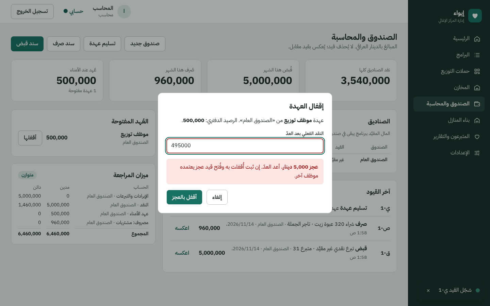

آخر اليوم «أقفلها»: اكتب النقد بعد العدّ. ما عُدَّ يرجع إلى الصندوق، والفرق يصير قيد عجز أو زيادة ينتظر الاعتماد.

### الدفع بالحوالة والمحفظة

لمن لا يحضر إلى النقطة. من صفحة الحملة المالية الجارية:

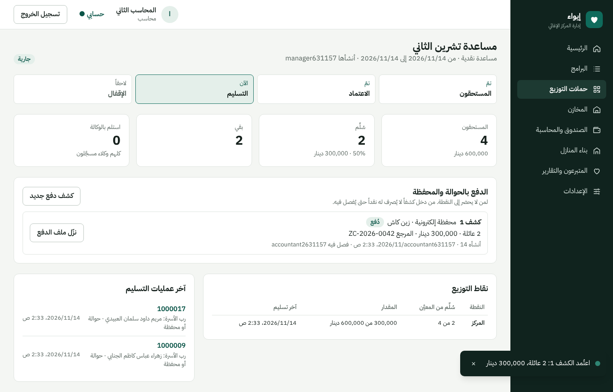

1. **«كشف دفع جديد»**: الطريقة (محفظة إلكترونية أو حوالة)، والجهة (شركة المحفظة أو مكتب الحوالة)، ثم اختر بالاسم من يُحوَّل له. من لا رقم هاتف له لا يدخل كشفاً.
2. **«نزّل ملف الدفع»**: فيه الاسم والرقم والمبلغ. به يُنفَّذ الدفع عند الشركة أو المكتب. تنزيله يُسجَّل باسمك.
3. **بعد أن يُنفَّذ الدفع فعلاً**، يفتح محاسب آخر أو المدير الكشف: «اعتماد بعد التنفيذ»، ويكتب **مرجع التنفيذ**.

بالاعتماد تُعدّ عوائل الكشف مستلِمة، وينقص نقد الصندوق بقيد واحد يحمل المرجع، وتصل كل عائلة رسالة بالتحويل؛ فمن لم يصله المال علم وراجع.

- **ما دام الكشف معلّقاً لا يُصرف لأصحابه نقداً**: رمزهم يُرفض عند الشبّاك برقم الكشف.
- إن تعذّر التنفيذ فـ«رفض» بسببه: يتحرر أصحابه. **لا ترفض كشفاً نُفّذ دفعه.**
- النظام لا يتصل بالشركة ولا بالمصرف: التنفيذ بيدك، والمرجع شهادتك عليه.

### المتبرعون والتقارير

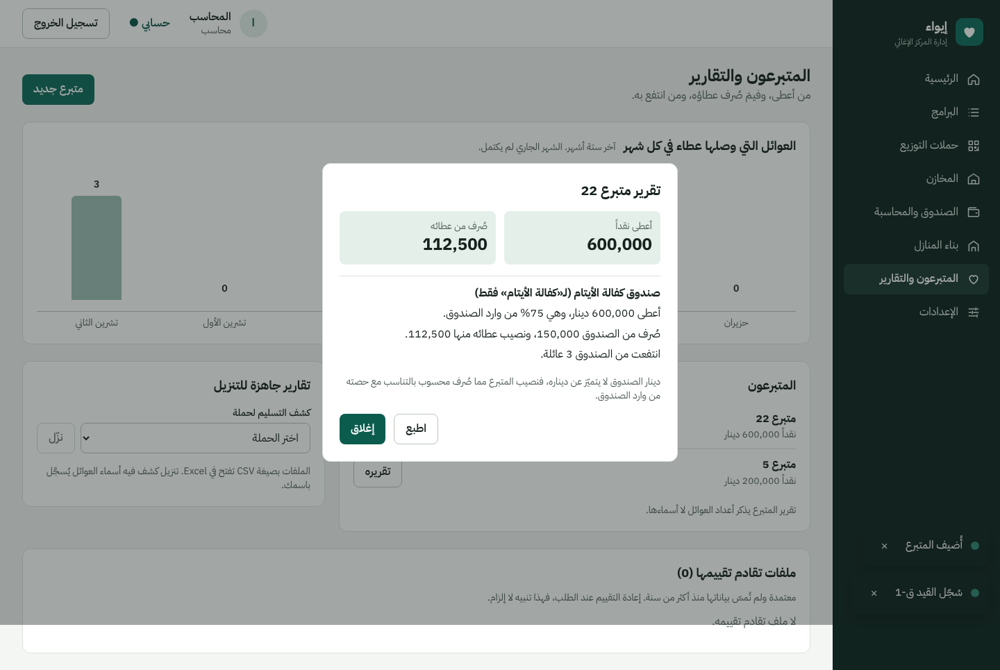

تقرير المتبرع: ما أعطى، ونصيبه مما صُرف، وعدد من انتفع (بلا أسماء). **نصيبه محسوب بالتناسب** مع حصته من وارد الصندوق، لأن دينار الصندوق لا يتميّز عن ديناره.

ومن الصفحة نفسها تُنزَّل الكشوف بصيغة يفتحها Excel.

---

## مشرف المشاريع

«بناء المنازل» ← «مشروع جديد»: رقم العائلة، الموقع، **المتعهد**، الصندوق، العقد، والمراحل بدفعاتها. الميزانية مجموع المراحل، وتُحجز من الصندوق حين يعتمد المشروعَ موظف آخر.

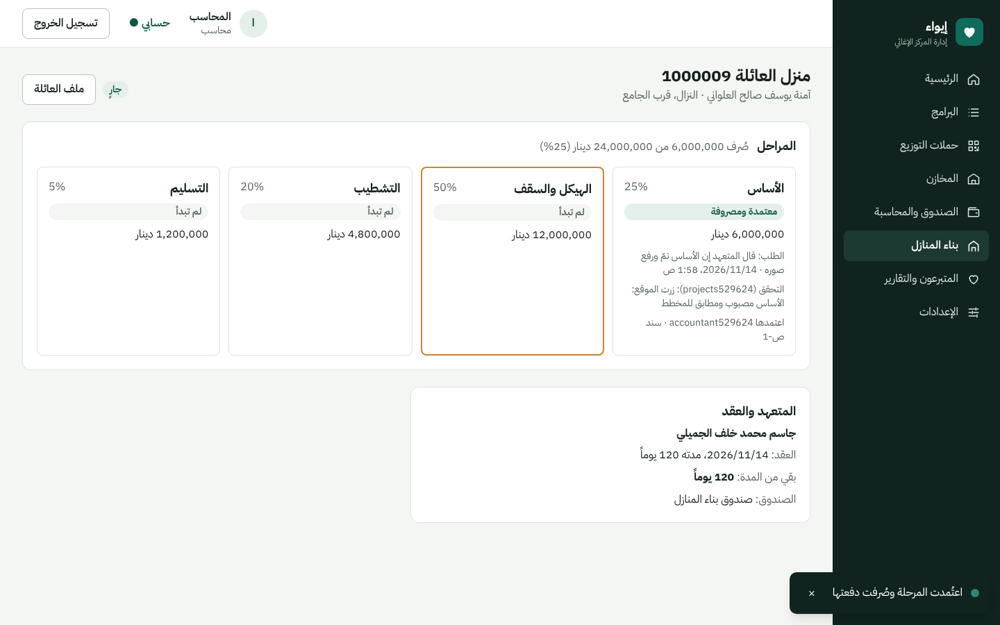

لكل مرحلة، بترتيبها:

1. **«طلب المتعهد صرفها»**: سجّل ما قاله وأرفق صوره.
2. **«سجّل زيارة التحقق»**: بعد أن تزور الموقع وترى بعينك.
3. **الاعتماد والصرف**: يقوم به **موظف غير الذي تحقق**، فتُصرف الدفعة بسند.

لا تُصرف دفعة مرحلة لم تُسجَّل لها زيارة تحقق. وإن لم تتمّ المرحلة: «أعِد إلى المتعهد» بسببه.

---

## المدقق

يقرأ كل شيء ولا يعدّل شيئاً: العوائل، سجل التدقيق وفحص سلامته، ميزان المراجعة، مطابقات الحملات، وعمليات كل موظف في مدة (من «المتبرعون والتقارير»).
